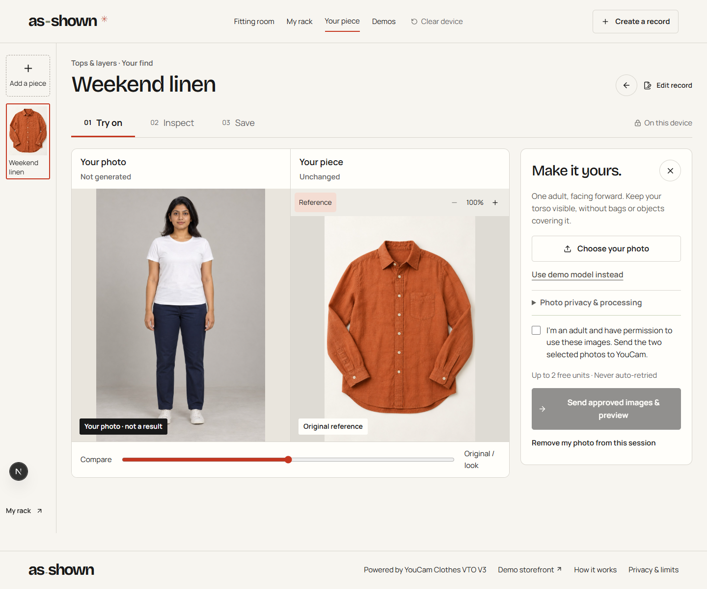

# As-Shown

Try on a secondhand find. Keep the original in view.

[Open the app](https://as-shown.vercel.app) · [Try a recorded demo](https://as-shown.vercel.app/examples/linen-shirt) · [Checks](https://github.com/kathir-iTech/as-shown/actions)



## One piece, three tools

1. **Try on:** upload an authorized garment photograph, select its category and add an adult photo. Nothing goes to YouCam until you explicitly approve the two inputs.
2. **Inspect:** check original source photos, seller disclosures and close-ups when available. Keep private questions; missing condition information stays missing.
3. **Save:** optionally retain the generated look on this device, or export the actual photos and notes as a verified ZIP or standalone offline HTML.

My Rack holds your own pieces, shortlists and collections. The three built-in garments are synthetic examples—not the available inventory.

Sellers can add versioned condition records and publish bounded, expiring, revocable seller-only links. Personal looks and buyer notes are excluded.

## Run locally

Node.js 24 and npm:

```sh
npm ci --ignore-scripts
node scripts/setup-local.mjs
npm run dev
```

Recorded demos, editing and exports work without an API key. Live generation is off by default. [Setup and free-tier boundaries](docs/LOCAL_SETUP.md) cover optional provider, ledger and storage configuration. Never commit credentials.

## Verify

```sh
npm run typecheck -- --incremental false
npm run lint
npm run format:check
npm test
npx playwright install chromium
npm run test:e2e
npm run build
npm audit --omit=dev
```

Ordinary tests use controlled provider responses, not API units. Real provider evidence is recorded separately. [Current usability release](docs/USABILITY_RELEASE.md) · [Earlier fitting-room evidence](docs/FITTING_ROOM.md)

## Know the limits

This is a limited-credit, non-commercial functional prototype, not a fit guarantee, defect detector, authenticity service or marketplace. Provider failures remain possible. A generated image cannot establish a garment’s condition.

Personal input photos stay in memory. Generated looks require separate local-save consent. YouCam processes approved images under its own [privacy policy](https://www.makeupar.com/perfectbeauty/youcam/privacy-policy-api); clearing this app does not delete provider-held data or downloaded files.

[Architecture and limits](docs/ARCHITECTURE.md) · [Asset provenance](docs/ASSET_LEDGER.md) · [Security dependency notes](docs/DEPENDENCY_SECURITY.md) · [MIT license](LICENSE)

Built with AI-assisted research, design, coding and testing. No commercial impact, universal accuracy, absolute novelty or winning guarantee is claimed.
