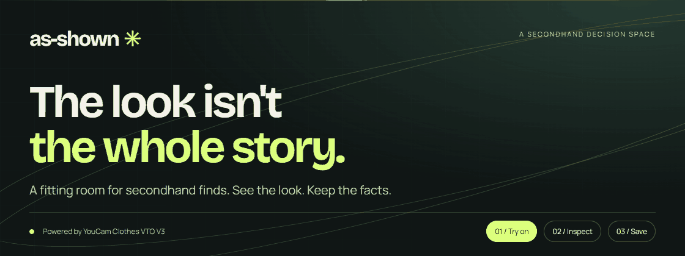
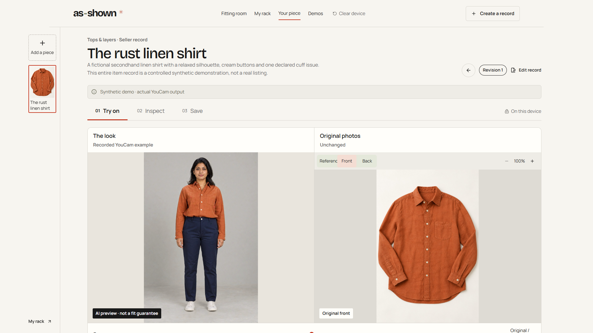

[Static header](docs/images/as-shown-poster.png) · [Live app](https://as-shown.vercel.app) · [Recorded YouCam demo](https://as-shown.vercel.app/examples/linen-shirt) · [Checks](https://github.com/kathir-iTech/as-shown/actions/workflows/quality.yml)

# As-Shown

A fitting room for secondhand finds. **See the look. Keep the facts.**

Virtual try-on answers “Would I like the style?” It cannot answer “What condition is this exact piece in?” As-Shown keeps the generated look, original source photos and your unanswered questions in the same decision—not the same image.

## One piece, three tools

1. **Try on:** upload an authorized garment photograph, select its category and add an adult photo. Nothing goes to YouCam until you explicitly approve the two inputs.
2. **Inspect:** check original source photos, seller disclosures and close-ups when available. Keep private questions; missing condition information stays missing.
3. **Save:** optionally retain the generated look on this device, or export the actual photos and notes as a verified ZIP or standalone offline HTML.

My Rack holds your own pieces, shortlists and collections. The three built-in garments are synthetic examples—not the available inventory.

Sellers can add versioned condition records and publish bounded, expiring, revocable seller-only links. Personal looks and buyer notes are excluded.

## Try it in two minutes

Open the [recorded linen-shirt example](https://as-shown.vercel.app/examples/linen-shirt). Select **Inspect**, open the linked source view, choose **Ask seller** and add a private question. In **Save**, acknowledge the private-image warning, download a readable HTML record and open it offline. No account, API key or generation credits are needed for this path.

The output is a real, previously generated YouCam result on a synthetic subject. The cuff photos are separate synthetic condition fixtures—not proof that the API detected or removed wear. [Judge walkthrough](docs/DEMO.md) · [Provenance](docs/ASSET_LEDGER.md)



## Beyond an image wrapper

| A decision needs…    | What the application actually does                                                                                                                   |
| -------------------- | ---------------------------------------------------------------------------------------------------------------------------------------------------- |
| A useful preview     | YouCam Clothes VTO V3; explicit tops, bottoms, full-body and shoe categories. Only two approved images are sent.                                     |
| The original context | Separate source views, seller-linked regions/close-ups, explicit missing information, revision-bound reviews. No automatic defect detection.         |
| A next action        | Private questions, a rack of your own finds, shortlists/collections, verified ZIP and script-free offline HTML exports.                              |
| A safe failure path  | Atomic request-intent admission, conservative credit reservations and recovery of known tasks. Unknown outcomes do not silently create replacements. |

```text
Your garment + adult photo ── explicit approval ── YouCam VTO
            │                                        │
            └── original source ── Inspect ── generated look
                                      │
                         private decision → ZIP / offline HTML
```

Next.js · React · TypeScript · IndexedDB · Sharp · Zod · Redis/Lua · optional private Blob storage. No general-purpose LLM is needed at runtime. [Architecture and data boundaries](docs/ARCHITECTURE.md)

## Run locally

Node.js 24 and npm:

```sh
npm ci --ignore-scripts
node scripts/setup-local.mjs
npm run dev
```

Recorded demos, editing and exports work without an API key. Live generation is off by default. [Setup and free-tier boundaries](docs/LOCAL_SETUP.md) cover optional provider, ledger and storage configuration. Never commit credentials.

## Verify

```sh
npm run typecheck -- --incremental false
npm run lint
npm run format:check
npm test
npx playwright install chromium
npm run test:e2e
npm run build
npm audit --omit=dev
```

Ordinary tests use controlled provider responses, not API units. Real provider evidence is recorded separately. [Current usability release](docs/USABILITY_RELEASE.md) · [Earlier fitting-room evidence](docs/FITTING_ROOM.md)

The 24 October release passed **77 unit/integration tests and 27 browser cases**, with all 27 also run against the public site. A separate real synthetic task completed and its actual result was verified, exported, saved by opt-in and reopened. These are scoped checks, not a bug-free or production certification. [Dated proof and CI links](docs/USABILITY_RELEASE.md)

## Know the limits

This is a limited-credit, non-commercial functional prototype, not a fit guarantee, defect detector, authenticity service or marketplace. Provider failures remain possible. A generated image cannot establish a garment’s condition.

Personal input photos stay in memory. Generated looks require separate local-save consent. YouCam processes approved images under its own [privacy policy](https://www.makeupar.com/perfectbeauty/youcam/privacy-policy-api); clearing this app does not delete provider-held data or downloaded files.

[Documentation index](docs/README.md) · [Asset provenance](docs/ASSET_LEDGER.md) · [Security dependency notes](docs/DEPENDENCY_SECURITY.md) · [MIT license](LICENSE)

Built with AI-assisted research, design, coding and testing. No commercial impact, universal accuracy, absolute novelty or winning guarantee is claimed.
